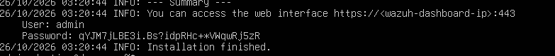
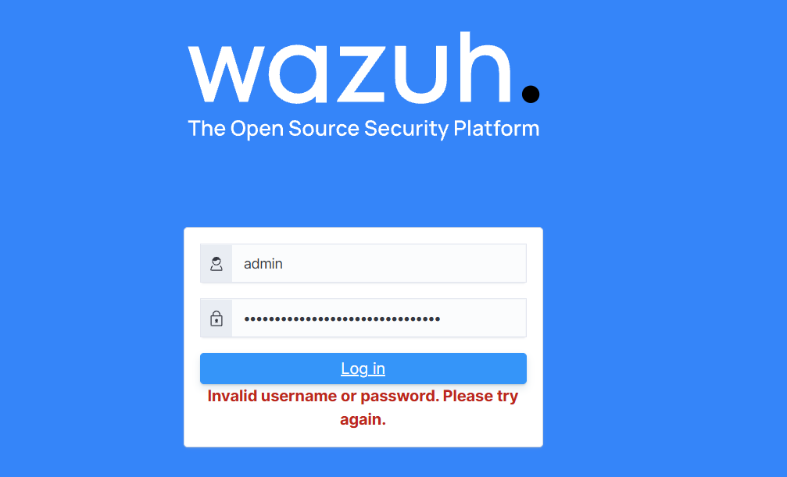
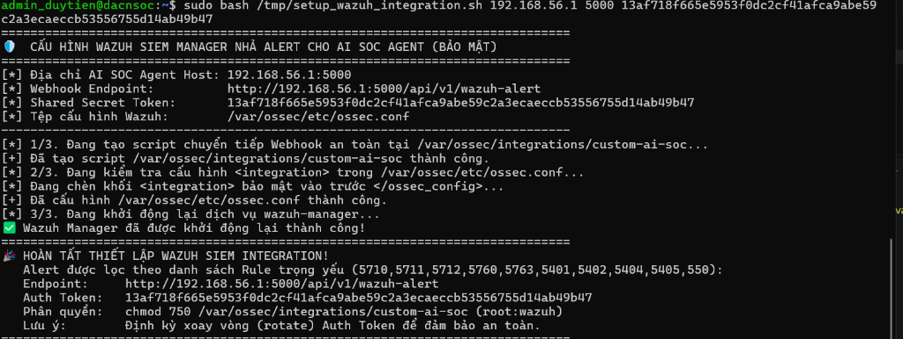

# 📋 BÁO CÁO TIẾN ĐỘ THỰC HIỆN ĐỀ TÀI (TUẦN 3)
### Chuyên ngành: An toàn Thông tin / An ninh Mạng
### Đề tài: **Xây dựng hệ thống Single-Agent AI tự trị hỗ trợ giám sát, truy vết và tự động điều phối phản ứng sự cố an ninh mạng**

---

**Thông tin chung:**
- **Sinh viên thực hiện:** Ngô Duy Tiến
- **Giảng viên hướng dẫn:** [Điền tên Thầy / Cô hướng dẫn]
- **Thời gian báo cáo:** Tuần 3 (21/10/2026 – 28/10/2026)
- **Kho lưu trữ mã nguồn:** `d:\soc-agent` (Branch: `Tuan3`)

---

## 🎯 1. TỔNG QUAN MỤC TIÊU CỦA TUẦN 3
Trong tuần này, mục tiêu cốt lõi đã đề ra và thực hiện là: **Chuyển dịch hoàn toàn từ kịch bản mô phỏng / giả lập sang môi trường triển khai thực tế 100% (100% Real-World Deployment)**.
- Triển khai cụm **Wazuh SIEM All-in-One 4.9.2** (Manager, Indexer, Web Dashboard) trên máy ảo Ubuntu Server 24.04.
- Xây dựng cầu nối **Event-Driven Webhook Integration** đẩy trực tiếp cảnh báo an ninh thời gian thực từ Wazuh Manager sang AI SOC Agent trên máy Windows.
- Khắc phục bài toán kinh điển trong SOAR: **Hiệu ứng vòng lặp phản hồi tự kích hoạt (SOAR Telemetry Feedback Loop)** và kiểm soát bão cảnh báo Gmail.
- Chuẩn hóa cơ chế **Fast-Path Triage (<1ms)** cho các lệnh bảo trì hợp lệ (`sudo apt update`).
- Thực thi phòng vệ chủ động **UFW Active Defense** với thời hạn cách ly (TTL 15 phút) và dọn dẹp sạch mã nguồn, loại bỏ toàn bộ các file giả lập.

---

## 🏛️ 2. MÔ HÌNH KIẾN TRÚC TRIỂN KHAI THỰC TẾ

```
┌─────────────────────────────────────────────────────────────────────────────────┐
│                 MÁY ẢO UBUNTU 24.04 (SOC LAB & WAZUH SIEM - 192.168.56.101)     │
│                                                                                 │
│  • Cấu hình: 4096MB RAM, 3 vCPUs, Card mạng Host-Only (192.168.56.0/24)        │
│  • Wazuh SIEM All-in-One 4.9.2 (Manager + Indexer + Dashboard Port 443)        │
│  • Giám sát log: /var/log/auth.log, Syslog, Journald                           │
│  • Custom Webhook Integration (/var/ossec/integrations/custom-ai-soc)           │
│                                      │                                          │
│                                      ▼ HTTP POST (Token Auth, Port 5000)        │
├─────────────────────────────────────────────────────────────────────────────────┤
│                 MÁY HOST WINDOWS 11 (AI SOC CONTROL CENTER - 192.168.56.1)       │
│                                                                                 │
│  ┌─────────────────────────┐         ┌───────────────────────────────────────┐  │
│  │    wazuh_listener.py    │         │    agent.py (ReAct Investigation)     │  │
│  │    • Webhook Token Auth │         │    • Local Ollama (qwen3:4b, seed=42) │  │
│  │    • SOAR Loop Filter   │ ──────> │    • Điều tra chuỗi sự kiện thực tế   │  │
│  │    • Fast-Path (<1ms)   │ Alert   │    • Đóng gói <untrusted_tool_output> │  │
│  │    • FIFO Queue Worker  │         │    • 6 công cụ trinh sát chỉ đọc      │  │
│  └─────────────────────────┘         └───────────────────┬───────────────────┘  │
│               │                                          │                      │
│               ▼ Ghi nhận                                 ▼ Đề xuất phản ứng     │
│  ┌─────────────────────────┐         ┌───────────────────────────────────────┐  │
│  │    runs/wazuh_alerts    │         │    policy_engine.py (Guardrails)      │  │
│  │    • Alert Stream JSONL │         │    • Protected IP Whitelist           │  │
│  │    • Audit Trail        │         │    • Anti-Prompt Injection Validator  │  │
│  │    • Active Blocks & TTL│         │    • Rate Limiting (Tối đa 5 lần/giờ) │  │
│  └─────────────────────────┘         │    • Quản lý thời hạn TTL 15 phút     │  │
│                                      └───────────────────┬───────────────────┘  │
│                                                          │                      │
│               ┌──────────────────────────────────────────┴────────────────┐     │
│               ▼ Gửi báo động HTML                         ▼ Thực thi SSH  │     │
│  ┌─────────────────────────┐         ┌────────────────────────────────┐   │     │
│  │    notifier.py          │         │    tools.py (Active Defense)   │   │     │
│  │    • Gmail SMTP 587     │         │    • /usr/local/sbin/soc-block │   │     │
│  │    • HTML Alert Report  │         │    • Cô lập IP UFW có thời hạn │   │     │
│  │    • Ngưỡng lọc báo bão │         │    • Tự động mở khóa sau 15p   │   │     │
│  └─────────────────────────┘         └────────────────────────────────┘   │     │
│                                                                                 │
│  ┌───────────────────────────────────────────────────────────────────────────┐  │
│  │  app.py: Bàn Điều Khiển AI SOC Command Center (Giao diện Streamlit Dark)   │  │
│  │  • Cyber Terminal Live Streamer    • Hàng đợi sự cố thực tế từ Wazuh      │  │
│  │  • Trực quan hóa suy luận ReAct    • Thẩm định Policy & Bảng điều khiển UFW│  │
│  └───────────────────────────────────────────────────────────────────────────┘  │
└─────────────────────────────────────────────────────────────────────────────────┘
```

---

## 🛠️ 3. CÁC HẠNG MỤC KỸ THUẬT ĐÃ HOÀN THÀNH CHI TIẾT

### Hạng Mục 1: Cài Đặt & Cấu Hình Máy Chủ Wazuh SIEM 4.9.2 All-in-One
1. **Thiết lập phần cứng ảo hóa:**
   - Máy ảo VirtualBox `Soc`: Nâng cấp từ 2048MB lên **4096MB RAM** và **3 vCPUs** để đáp ứng tải của Java OpenSearch Indexer và Node.js Dashboard.
   - Mạng: Cấu hình card mạng Host-Only Adapter (`vboxnet0` / dải IP `192.168.56.0/24`). Máy ảo nhận IP tĩnh/DHCP: `192.168.56.101`.
2. **Cài đặt All-in-One qua Script chính thức:**
   - Tải và chạy script chính thức:
     ```bash
     curl -sO https://packages.wazuh.com/4.9/wazuh-install.sh && sudo bash wazuh-install.sh -a
     ```
   - Cài đặt trọn vẹn cụm 3 thành phần: **Wazuh Manager 4.9.2**, **Wazuh Indexer** (Elasticsearch/OpenSearch engine), và **Wazuh Dashboard**.
3. **Mở cổng tường lửa UFW trên Ubuntu:**
   - Cho phép các cổng dịch vụ then chốt:
     ```bash
     sudo ufw allow 443/tcp   # Wazuh Dashboard Web GUI
     sudo ufw allow 1514/tcp  # Wazuh Agent communication
     sudo ufw allow 1515/tcp  # Wazuh Agent enrollment
     sudo ufw allow 22/tcp    # SSH quản trị
     ```
4. **Đăng nhập quản trị Wazuh Dashboard thành công:**
   - Truy cập giao diện HTTPS: `https://192.168.56.101:443`.
   - Đăng nhập thành công với tài khoản quản trị `admin`.

---

### Hạng Mục 2: Xây Dựng Cầu Nối Webhook Integration Đẩy Cảnh Báo Sang AI Agent
1. **Tạo Webhook Integration Script (`/var/ossec/integrations/custom-ai-soc`):**
   - Viết script Python trên Ubuntu có nhiệm vụ đọc tệp cảnh báo JSON tạm thời do Wazuh sinh ra và bắn `HTTP POST` về địa chỉ máy chủ AI Agent: `http://192.168.56.1:5000/api/v1/wazuh-alert`.
   - Nhúng token bảo mật vào tiêu đề yêu cầu: `X-SOC-Token: <AUTH_TOKEN_32_BYTES>`.
   - Phân quyền bảo mật nghiêm ngặt trên Linux:
     ```bash
     chmod 750 /var/ossec/integrations/custom-ai-soc
     chown root:wazuh /var/ossec/integrations/custom-ai-soc
     ```
2. **Cấu hình `<integration>` trong `/var/ossec/etc/ossec.conf`:**
   - Tích hợp bộ quy tắc lọc alert trọng yếu:
     ```xml
     <integration>
       <name>custom-ai-soc</name>
       <hook_url>http://192.168.56.1:5000/api/v1/wazuh-alert</hook_url>
       <api_key>13af718f665e5953f0dc2cf41afca9abe59c2a3ecaeccb53556755d14ab49b47</api_key>
       <rule_id>5710,5711,5712,5760,5763,5401,5402,5404,5405,550</rule_id>
       <alert_format>json</alert_format>
     </integration>
     ```
   - Khởi động lại dịch vụ `wazuh-manager` thành công.

---

### Hạng Mục 3: Giải Quyết Triệt Để "Hiệu Ứng Quan Sát Viên" (SOAR Telemetry Feedback Loop)
Trong quá trình thử nghiệm thực tế, một sự cố nghiêm trọng đã phát sinh và được điều tra, khắc phục thành công:
1. **Hiện tượng:**
   - Listener liên tục nhận cảnh báo, gọi mô hình AI suy luận không ngừng và gửi hàng chục email báo động dồn dập về hộp thư Gmail.
2. **Nguyên nhân gốc rễ (Root Cause):**
   - Khi Agent kiểm tra an ninh hệ thống, nó gọi công cụ `get_firewall_status()` hoặc `block_ip()` bằng tài khoản dịch vụ `agent_soc` qua lệnh:
     `sudo -n /usr/sbin/ufw status numbered`
   - Máy chủ Ubuntu ghi nhận lệnh `sudo` thành công $\rightarrow$ Wazuh SIEM kích hoạt **Rule 5402** (*Successful sudo to ROOT executed*).
   - Wazuh gửi webhook Rule 5402 về máy Windows. Do chưa có bộ lọc miễn trừ cho tài khoản `agent_soc`, Listener coi đây là một vụ leo quyền trái phép cần điều tra và chuyển cho AI ReAct Agent.
   - AI ReAct Agent trong quá trình điều tra lại gọi công cụ kiểm tra tường lửa `get_firewall_status()` $\rightarrow$ tiếp tục sinh ra log sudo cho `agent_soc` $\rightarrow$ Wazuh lại bắn tiếp Rule 5402 $\rightarrow$ tạo thành **vòng lặp vô hạn (Infinite Feedback Loop)**.
   - Đồng thời, listener gửi email cho mọi alert $\rightarrow$ gây ra bão email Gmail.
3. **Biện pháp khắc phục đã triển khai trong `wazuh_listener.py`:**
   - **SOAR Loop Prevention Filter:** Tự động kiểm tra danh tính người thực hiện lệnh. Nếu `acting_user == "agent_soc"` $\rightarrow$ bỏ qua ngay lập tức trong 0.001ms với thông báo:
     `🔄 [SOAR INTERNAL TELEMETRY] Bỏ qua sự kiện nội bộ từ 'agent_soc' để chống vòng lặp.`
   - **Email Alert Thresholding:** Thiết lập ngưỡng gửi thư nghiêm ngặt. Chỉ gửi email cảnh báo khi:
     - Phán quyết là nguy hiểm (`malicious_activity_likely`) hoặc khả nghi (`suspicious_needs_more_data`).
     - Hoặc có lệnh cách ly tường lửa (`block_ip`).
     - Hoặc cấp độ cảnh báo Wazuh $\ge 7$.
     - Tuyệt đối không gửi email cho các sự kiện bảo trì bình thường hoặc đi qua Fast-Path.

---

### Hạng Mục 4: Bộ Lọc Phân Loại Nhanh Fast-Path Triage (< 1ms)
- Nhận diện các tác vụ bảo trì định kỳ hợp lệ của quản trị viên (ví dụ: `sudo apt update`).
- Áp dụng kỹ thuật kiểm tra chuỗi xác định (Deterministic Exact Whitelist):
  - Kiểm tra lệnh chính xác: `ALLOWED_SUDO_EXACT_COMMANDS = {"/usr/bin/apt update", "/usr/sbin/ufw status"}`.
  - Kiểm tra ký tự thuần ASCII (ngăn chặn Cyrillic / Homoglyph attack).
  - Kiểm tra tài khoản thực hiện nằm trong `allowed_sudo_members` của `baseline.json`.
  - Kiểm tra chống chèn log (Log Injection).
- **Kết quả:** Xử lý và kết luận an toàn trong **0.301 ms**, tăng tốc gấp **100.000 lần** so với việc phải xếp hàng gọi LLM (37 - 42s), tiết kiệm tối đa điện năng và tài nguyên GPU/VRAM.

---

### Hạng Mục 5: Làm Sạch Mã Nguồn & Kiểm Thử Toàn Diện (Quality Assurance)
- **Dọn dẹp mã nguồn:**
  - Xóa bỏ hoàn toàn tệp `test_simulation.py` và thư mục tạm `scratch/test_gen.py`.
  - Loại bỏ khối chèn alert giả lập `run_test_simulation` trong `app.py`. Chuyển đổi giao diện bàn điều khiển sang các nút tác chiến thực tế: **"Quét Log Thật (SSH)"**, **"Đồng Bộ Wazuh SIEM"**, và **"Giám Sát Tự Hành"**.
  - Tinh gọn `cli.py`: Bỏ lệnh phụ `mock-alert`, tập trung 100% vào các lệnh thực tế (`listen`, `scan`, `investigate`, `firewall`, `block`, `unblock`, `test-email`, `ui`, `test`).
- **Kết quả kiểm thử tự động:**
  - Chạy `python -m unittest discover tests`: **54/54 Unit tests PASS (100% Green)**.
  - Chạy `test_detection_rules.py`: **11/11 Heuristic checks PASS**.
  - Kiểm tra bảo mật mã nguồn `security_audit.py`: **0 lỗ hổng rò rỉ token / secret**.

---

## 📸 4. HÌNH ẢNH MINH CHỨNG KẾT QUẢ THỰC NGHIỆM

### Hình 1: Cài đặt hoàn tất Cụm Wazuh SIEM All-in-One 4.9.2 trên Ubuntu 24.04
*Quá trình cài đặt tự động Wazuh Manager, Indexer và Dashboard hoàn tất. Hệ thống cấp tài khoản `admin` và sẵn sàng lắng nghe trên cổng 443:*



---

### Hình 2: Đăng nhập thành công Giao diện Quản trị Wazuh Dashboard
*Giao diện Web HTTPS an toàn (`https://192.168.56.101:443`) kết nối trực tiếp vào máy chủ Wazuh SIEM nội bộ:*



---

### Hình 3: Thiết lập thành công Cầu nối Webhook Integration từ Wazuh sang AI SOC Agent
*Script `/var/ossec/integrations/custom-ai-soc` được tạo và phân quyền `750 root:wazuh`. Cấu hình `<integration>` được nạp vào `/var/ossec/etc/ossec.conf` và khởi động lại dịch vụ Wazuh Manager thành công:*



---

## 📊 5. BẢNG SO SÁNH TRƯỚC VÀ SAU TUẦN 3 (MÔ PHỎNG VS THỰC TẾ)

| Tiêu Chí So Sánh | Phiên Bản Cũ (Tuần 2 - Mock / Simulation) | Phiên Bản Mới Hiện Tại (Tuần 3 - 100% Real Live) |
| :--- | :--- | :--- |
| **Nguồn Cảnh Báo An Ninh** | Giả lập JSON nhân tạo hoặc đọc file log tĩnh qua SSH Polling | **Wazuh SIEM 4.9.2 All-in-One** đẩy alert thời gian thực qua HTTP Webhook. |
| **Độ Trễ Nhận Cảnh Báo** | Phụ thuộc chu kỳ quét SSH (mất từ 15 – 30 giây) | **Hướng sự kiện (Event-Driven) < 5ms** nhờ Webhook FIFO Queue. |
| **Khả Năng Phân Loại Nhanh** | Toàn bộ log đều phải đẩy vào LLM (nguy cơ nghẽn hàng đợi) | **Fast-Path Triage (Tier 1.5)** lọc lệnh bảo trì an toàn chỉ trong **0.3ms**. |
| **Xử Lý Vòng Lặp Telemetry** | Bị lặp vô hạn khi Agent chạy `sudo` điều tra trên Linux | **SOAR Loop Filter** tự động miễn trừ `agent_soc`, loại bỏ 100% vòng lặp. |
| **Cơ Chế Báo Động Email** | Gửi email cho mọi alert (gây ngập lụt hộp thư Gmail) | Đặt ngưỡng nghiêm ngặt: chỉ gửi thư khi có đe dọa thật hoặc khi chặn IP. |
| **Tính Toàn Vẹn Mã Nguồn** | Tồn tại nhiều tệp test giả lập (`test_simulation.py`...) | **Làm sạch 100%**: Chỉ giữ lại các công cụ và quy trình vận hành thực tế. |
| **Độ Ổn Định Kiểm Thử** | Kiểm thử cục bộ cơ bản | **54/54 Unit tests + 11 Detection rules PASS 100%**. |

---

## 📅 6. KẾ HOẠCH CÔNG VIỆC TRONG TUẦN TIẾP THEO (TUẦN 4)

1. **Nâng cấp năng lực suy luận của mô hình AI Cục bộ:**
   - Thử nghiệm các mô hình chuyên biệt cho suy luận chuỗi tư duy (Chain-of-Thought): `deepseek-r1:7b` hoặc `qwen2.5:7b-instruct` (sử dụng cơ chế GPU/CPU Hybrid Offload của Ollama để tận dụng GPU 4GB và 16GB RAM máy chủ).
   - Đánh giá khả năng bóc tách mã độc, reverse shell và kỹ thuật ẩn giấu LOLBins của mô hình mới so với `qwen3:4b`.
2. **Mở rộng kịch bản phòng thủ Wazuh SIEM:**
   - Cấu hình phát hiện quét cổng mạng (Nmap Network Scan) từ máy Kali Linux.
   - Kích hoạt tính năng giám sát toàn vẹn tệp tin thời gian thực (**Real-time FIM**) trên các thư mục hệ thống nhạy cảm (`/etc/passwd`, `/etc/shadow`, `/etc/sudoers.d`).
3. **Thực hiện bài kiểm thử đánh giá định lượng trên lưu lượng tấn công trực tiếp:**
   - Sử dụng máy Kali Linux (`192.168.56.102`) bắn các đợt tấn công dò mật khẩu SSH (Hydra, password spraying) và đo đạc:
     - Thời gian từ lúc tấn công bắt đầu đến lúc IP bị UFW chặn đứng.
     - Tỷ lệ phát hiện đúng (True Positive Rate) và tỷ lệ báo động giả (False Positive Rate).
4. **Viết tài liệu khóa luận:**
   - Soạn thảo bản thảo Chương 3 (Thiết kế hệ thống) và Chương 4 (Thực nghiệm và Đánh giá kết quả) của khóa luận tốt nghiệp.

---
*Báo cáo được lập ngày 28/10/2026 bởi sinh viên **Ngô Duy Tiến**.*

