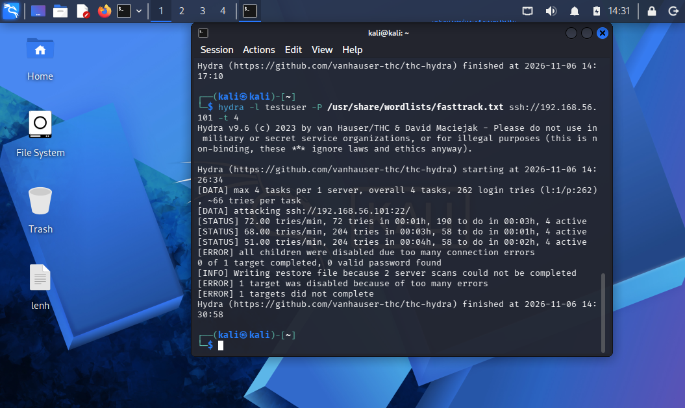
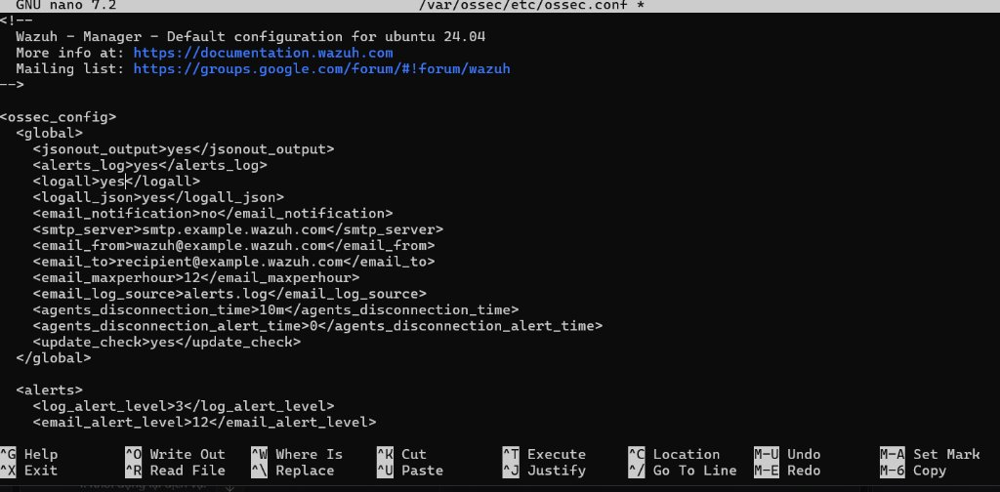

# 📋 BÁO CÁO TIẾN ĐỘ TUẦN 5
### Đề tài: **Xây dựng hệ thống Single-Agent AI tự trị hỗ trợ giám sát, truy vết và tự động điều phối phản ứng sự cố an ninh mạng**
**Sinh viên:** Ngô Duy Tiến | **Thời gian:** Tuần 5 (01/11/2026 – 07/11/2026)

---

## 1. HỆ THỐNG HOẠT ĐỘNG NHƯ THẾ NÀO?

Hệ thống hoạt động tự động theo quy trình 5 bước:

```
[1. Kali Linux] ──── Tấn công Brute Force SSH ────► [2. Ubuntu Server (Wazuh)]
                                                              │
                                                   Phát hiện Rule 5712 (Level 10)
                                                              │
                                                              ▼ (Gửi Webhook JSON)
[4. Tường lửa UFW] ◄── Lệnh chặn IP ── [3. Windows Host (SOC Agent)]
(Chặn đứng Kali ngay lập tức)                 ├── Policy Engine: Kiểm tra Whitelist
                                              ├── Local LLM: Phân tích & Gắn thẻ MITRE
                                              └── Gửi Email cảnh báo tới Admin [5]
```

1. **Tấn công:** Máy Kali Linux (`192.168.56.10`) dùng Hydra dò mật khẩu SSH vào Ubuntu Server (`192.168.56.101`).
2. **Phát hiện:** Wazuh SIEM trên Ubuntu thấy đăng nhập sai nhiều lần ➔ kích hoạt cảnh báo **Rule 5712 (Level 10)** ➔ bắn Webhook JSON sang máy Windows.
3. **Kiểm tra an toàn (Policy Engine):** Agent kiểm tra IP tấn công (không phải IP admin/whitelist, chưa vượt ngưỡng chặn).
4. **Tự động chặn (Active Defense):** Agent kích hoạt tường lửa **UFW** trên Ubuntu: `ufw insert 1 deny from 192.168.56.10`. Kali bị ngắt kết nối và công cụ Hydra bị dừng ngay lập tức.
5. **Báo cáo:** AI phân tích kỹ thuật theo chuẩn MITRE ATT&CK (T1110) và tự động gửi email báo cáo sự cố về Gmail cho quản trị viên.

### 📸 Hình ảnh minh chứng thực tế:

*Hình 1: Máy Kali Linux tấn công Hydra bị tường lửa chặn đứng hoàn toàn (`all children were disabled`).*


*Hình 2: Cấu hình Wazuh Archive để lưu trữ toàn bộ lịch sử phục vụ Agent điều tra.*

---

## 2. HIỆN TẠI ĐÃ LÀM ĐẾN ĐÂU?

- **Kiến trúc Zero-Trust:** Bỏ hoàn toàn việc SSH vào đọc file log thô; Agent nhận 100% dữ liệu từ Wazuh SIEM qua Webhook.
- **Thực nghiệm tấn công thực tế:** Kết nối thành công máy ảo Kali Linux (`192.168.56.10`) tấn công máy chủ Ubuntu (`192.168.56.101`).
- **Tự động phản ứng & Ngăn chặn:** Tường lửa UFW tự động chặn IP Kali khi Wazuh phát hiện Brute Force.
- **Gửi cảnh báo qua Gmail:** Đã cấu hình gửi mail báo cáo sự cố thành công về `duytien0125@gmail.com`.
- **Kiểm thử tự động:** Vượt qua toàn bộ **59/59 bài test (100% PASS)** và **11/11 luật phát hiện an ninh**.

---

## 3. CÁC VẤN ĐỀ ĐANG GẶP PHẢI

1. **Local LLM chạy chậm (Độ trễ cao):** Mô hình Qwen 3:4B chạy trên GPU laptop cá nhân (RTX 3050 - 4GB VRAM) mất **15 – 20 giây** cho một lần suy luận, khiến việc xử lý và gửi mail bị trễ so với tốc độ tấn công.
2. **Phản ứng chặn bị chậm nếu chờ AI:** Chặn IP cần diễn ra trong **dưới 1 giây**, nhưng nếu phải đợi AI suy luận xong mới chặn thì kẻ tấn công đã kịp thử thêm hàng trăm mật khẩu. Cần tách thành: *chặn trước bằng luật cứng ➔ AI phân tích báo cáo sau*.
3. **Giới hạn phần cứng (VRAM 4GB):** Bộ nhớ GPU quá nhỏ, không thể chạy các mô hình lớn hơn (7B, 14B) để có khả năng suy luận logic và tiếng Việt tốt hơn.
4. **Mô hình suy nghĩ quá dài:** Local LLM tự sinh thẻ `<think>...</think>` dài dòng, dễ làm cạn hạn mức token gây đứt đoạn câu trả lời JSON.
