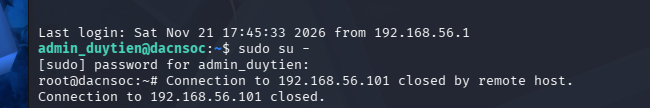
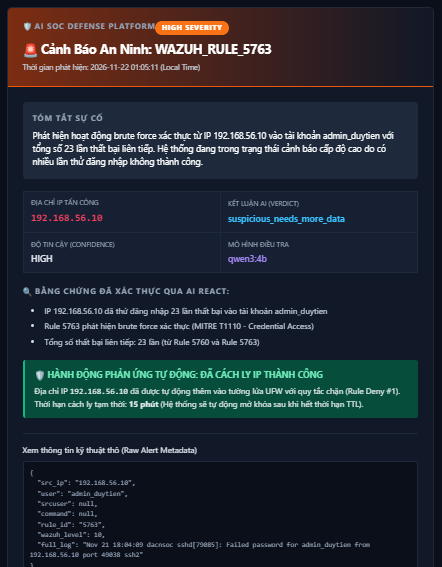
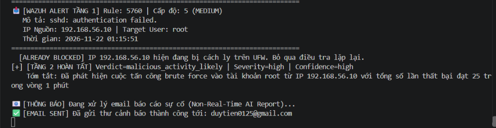
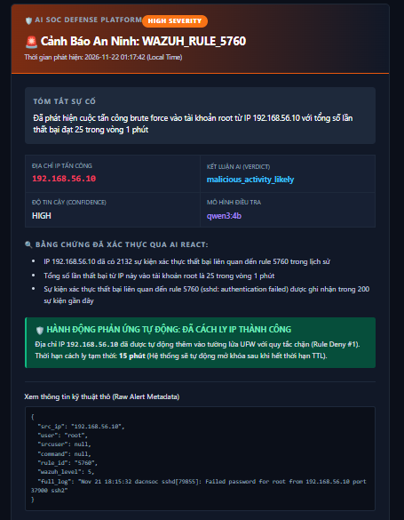

# 📋 BÁO CÁO TIẾN ĐỘ TUẦN 6
### Đề tài: **Xây dựng hệ thống Single-Agent AI tự trị hỗ trợ giám sát, truy vết và tự động điều phối phản ứng sự cố an ninh mạng**
**Sinh viên thực hiện:** Ngô Duy Tiến | **Thời gian:** Tuần 6 (15/11/2026 – 22/11/2026)

---

## 1. ĐANG LÀM ĐẾN ĐÂU RỒI & HỆ THỐNG VẬN HÀNH NHƯ THẾ NÀO

### 1.1. Đang làm đến đâu rồi
Tuần 6 đã hoàn thành xuất sắc mục tiêu quan trọng nhất theo đúng chỉ dẫn của Giảng viên: **Chuyển toàn bộ việc kiểm thử từ mô phỏng sang thực chiến 100% bằng tay trên hệ thống 3 máy ảo thật** (Kali `192.168.56.10` ➔ Ubuntu Server/Wazuh `192.168.56.101` ➔ Windows Agent `192.168.56.1`), không sử dụng script giả lập.

Hệ thống đã kiểm chứng thành công trọn vẹn 3 kịch bản thực tế:
1. **Kịch bản 1 — Tấn công nhiều bước thật (Multi-step Kill-Chain):**
   - Từ Kali: Dò mật khẩu chậm 4 lần (né ngưỡng 8 lần của Wazuh) ➔ Đăng nhập SSH thành công vào `admin_duytien` ➔ Gõ `sudo su -` leo quyền root.
   - **Kết quả thực tế:** Dù log `sudo` không chứa IP nguồn, Agent Tầng 1 đã tự động truy vết ngược ra IP Kali, chèn lệnh chặn UFW và **ngắt ngay lập tức phiên SSH đang chiếm root** (`Connection closed by remote host`).
2. **Kịch bản 2 — Chống chặn nhầm Admin & Ngưỡng an toàn (Anti-Lockout & Boundary Guard):**
   - Admin gõ sai mật khẩu: Hệ thống nhận diện nhịp gõ tay con người và tài khoản hợp lệ để **không tự khóa nhầm IP quản trị**.
   - Khi vượt ngưỡng an toàn (thử sai dồn dập 23 lần): Agent lập tức chuyển sang chế độ bảo vệ, chặn UFW và gửi email cảnh báo về `duytien0125@gmail.com`.
3. **Kịch bản 3 — Tấn công Hydra tốc độ cao (High-Velocity Brute Force):**
   - Dùng Hydra quét mật khẩu tài khoản `root`: Tầng 1 phản ứng chặn tức thì (**dưới 0.5 giây**), dập tắt công cụ tấn công ngay từ nhịp đầu; Tầng 2 AI phân tích lịch sử 2.132 sự kiện và kết luận `malicious_activity_likely`.

---

### 1.2. Hệ thống vận hành như thế nào trong thực tế (Hình ảnh minh chứng)

```
[Máy Tấn công Kali 192.168.56.10]
          │ (SSH Brute force / Leo quyền sudo)
          ▼
[Ubuntu Server 192.168.56.101 - Wazuh Manager]
          │ (Webhook đẩy alert JSON <5ms)
          ▼
[Windows Host 192.168.56.1 - SOC Agent Hybrid 2 Tầng]
          ├── TẦNG 1 (Thời gian thực <0.5s):
          │    ├── Tương quan Kill-Chain & Kiểm tra Policy Whitelist
          │    ├── Chặn ngay IP trên UFW (Rule Deny #1)
          │    └── Ngắt phiên SSH kẻ xâm nhập (/usr/local/sbin/soc-kill-session)
          │
          └── TẦNG 2 (Chạy nền ~15-20s):
               ├── Local LLM (qwen3:4b) phân tích sâu, gắn MITRE ATT&CK
               └── Gửi Email báo cáo HTML chuẩn SOC tới duytien0125@gmail.com
```

#### 📸 Hình ảnh minh chứng thực tế thu thập từ Lab:


*Hình 1: Kịch bản 1 — Kẻ tấn công trên Kali vừa gõ `sudo su -` lập tức bị Agent ngắt phiên và chặn IP triệt để.*



*Hình 2: Kịch bản 2 — Bản tin cảnh báo chi tiết do AI sinh ra (Rule 5763, MITRE T1110, Qwen3:4b) kèm thông báo cách ly UFW 15 phút.*



*Hình 3: Kịch bản 3 — Toàn trình vận hành: Tầng 1 kiểm tra thấy IP đã bị chặn và ngắt lặp lại, Tầng 2 AI phân tích hoàn tất và tự động gửi Email tới duytien0125@gmail.com.*


*Hình 4: Kịch bản 3 — Tầng 2 AI đọc lịch sử Wazuh, đưa ra kết luận tấn công Brute Force 25 lần/phút.*

---

## 2. CÁC VẤN ĐỀ ĐANG GẶP PHẢI

1. **Bộ nhớ RAM/VRAM khi LLM chạy nền liên tục:**
   - Khi chạy Local LLM (`qwen3:4b`) trên GPU laptop 4GB VRAM, mô hình vẫn chiếm ~2.34 GB VRAM và tràn ~1.19 GB sang RAM. Nếu có nhiều cảnh báo dồn dập, hàng đợi Tầng 2 cần xử lý tuần tự (FIFO) để tránh quá tải tài nguyên máy tính.
2. **Đồng bộ hóa trạng thái bộ nhớ đệm (Cache Invalidation):**
   - Trạng thái tương quan lưu trong RAM tiến trình Agent (`self._ip_states`) cần có cơ chế dọn dẹp định kỳ sau khi hết hạn cách ly TTL để tránh tích lũy số đếm của phiên làm việc cũ.
3. **Phụ thuộc vào dịch vụ Wazuh Integratord:**
   - Cơ chế Webhook yêu cầu tiến trình `wazuh-integratord` trên Ubuntu Server hoạt động liên tục; nếu service này bị dừng đột ngột, Agent sẽ không nhận được alert đẩy sang.

---

## 3. KẾ HOẠCH CHO TUẦN TIẾP THEO

1. **Tổng hợp toàn bộ số liệu và hình ảnh vào báo cáo:**
   - Đưa bảng so sánh định lượng (Wazuh mặc định vs. AI Agent) và 4 hình ảnh minh chứng thực tế vào Chương Thực nghiệm & Đánh giá kết quả.
